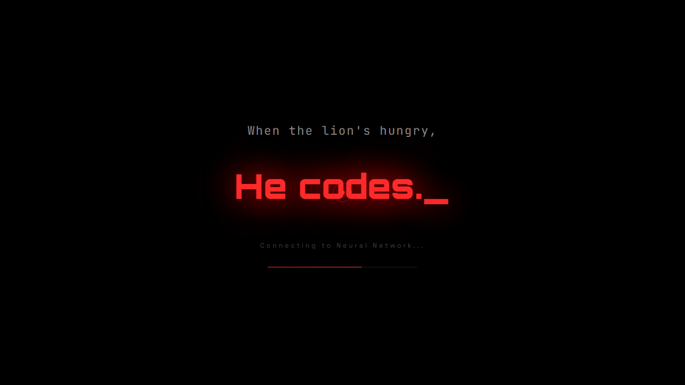

## Portfolio

  

  

**[www.aryantyagi.in →](https://www.aryantyagi.in)**

## About me

I’m an **app, web, and AI developer** who enjoys turning ambitious ideas into thoughtful, usable products. From mobile computer-vision workflows to AI-powered web experiences, I build at the intersection of clean UX and practical engineering.

-  Building intelligent, human-centered applications
-  Exploring mobile development with Flutter
-  Shipping interactive web experiences
-  Open to collaborating on AI, app, and web projects

## My toolkit

  

## Featured builds

<table>
<tr>
<td width="50%" valign="top">

### [Smart Attendance System](https://github.com/aryann-tyagi/smart_attendance_flutter)

A privacy-minded Flutter attendance app using face detection, video processing, confidence-based matching, local SQLite storage, and CSV exports.

**Flutter · Dart · Google ML Kit · SQLite**

</td>
<td width="50%" valign="top">

### [Healthify AI](https://github.com/aryann-tyagi/healthify)

An AI-powered healthcare experience with symptom insights, prescription OCR, an AI assistant, and interactive 3D visuals.

**JavaScript · Three.js · Tailwind · Appwrite · Groq**

</td>
</tr>
<tr>
<td width="50%" valign="top">

### [EcoCampus](https://github.com/aryann-tyagi/Ecocampus)

A full-stack campus sustainability platform with a Flutter reporting app, real-time admin dashboard, and Gemini-powered issue intelligence.

**Flutter · Next.js · TypeScript · Supabase · Gemini**

</td>
<td width="50%" valign="top">

### Building what’s next

I’m always experimenting with products where AI, mobile, and web engineering make everyday work simpler.

**AI · Product · Full stack**

</td>
</tr>
</table>
